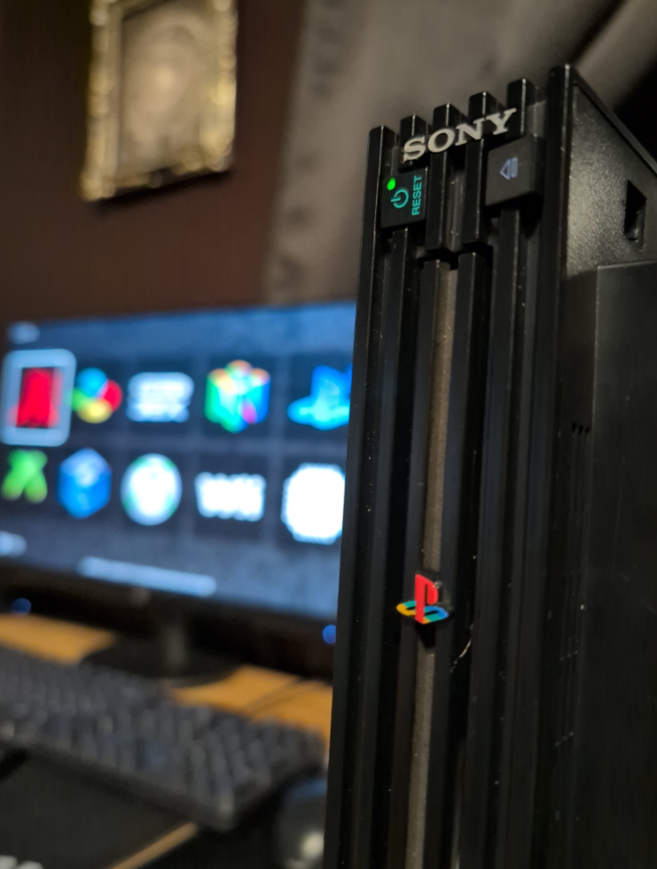

# Playstation 2 Steam Box
Steam box on a mini PC built into a PS2 chassis. 

### Materials
- Playstation 2
- Ryzen4300u MiniPC
- Assortment of wires and connectors (anything to connect the power LED)
- Ethernet keystone (coupler) and cable
- USB3-A coupler and cable
- USBC coupler and cable
- HDMI coupler and cable